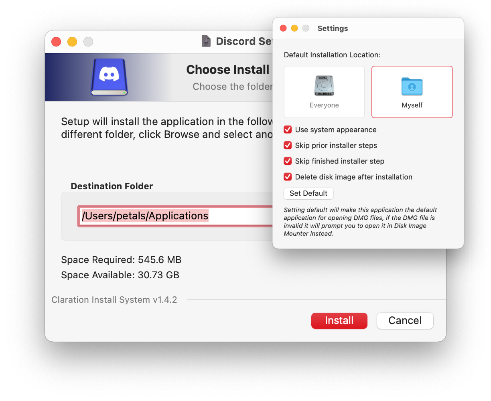
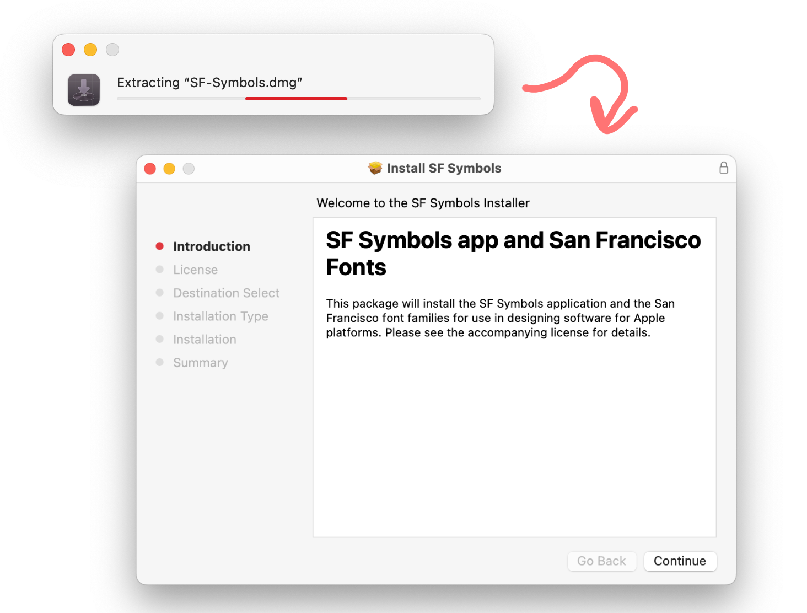

# Claration Install System

[](https://github.com/claration/cis/blob/main/LICENSE)
[](https://github.com/sponsors/claration)

CIS allows you to open DMG files into an installer-like interface which directly extracts apps into applications without the need of the pain of dragging and dropping or waiting it to mount.



Here's an example of CIS installing [Discord](https://discord.com/)'s distributed `.dmg` file. It should work with most of these files, it just depends on how distributes made them.

## Design Philosophy

### DMG files

If you're someone coming from Windows and now using macOS, you will recognize that this [looks like NSIS](https://nsis.sourceforge.io/Main_Page)! This was intentional as it serves a good baseline for installer interfaces people recognize, however you can customize how the installer works to your liking!

- Supports skipping some installer steps to be be less-like the Windows experience.
- Supports some default options for destination folders & trashing the DMG file afterwards.

DMG files are not mounted! They are read and processed in memory, while trying to preserve near-native speeds when extracting files.

CIS will extract any `.app` directories embedded in DMG files into a destination directory, however you can customize it in the App Picker section in the installer. Though, setting the option to skip all the needless steps like this one will hinder that ability.

### PKG files inside of DMG files

DMG files which house PKG files (e.g. [SF Symbols](https://developer.apple.com/sf-symbols/)) are also supported! CIS will extract any available PKG files and open them into the macOS package installer.



CIS will first check for any available `.app` directories, if it can't find anything it will then search and extract any available `.pkg` files into a temporary directory, then execute the built-in macOS installer for these files.

## Download

Visit [releases](https://github.com/claration/cis/releases) and get the latest version for your computer.

## Building

You will need [Xcode](https://developer.apple.com/xcode/) for compilation. For packaging a `.dmg`, you will need Homebrew and will need to install some dependencies, look below for more information.

```sh
$ git clone https://github.com/claration/cis.git
$ cd cis
$ make build # optionally add DMG=1 for dmg
```

<details>
<summary>DMG building (click to expand)</summary>

When making a DMG, there's only one dependency you need and it's from Homebrew (sadly!)\

```sh
$ brew install create-dmg
```

</details>

The output of the app will be in `_build/Applications/*.app` | `_build/*.dmg`

> [!IMPORTANT]
> When debugging, CIS is going to try and by default open to a hardcoded path on my computer (sorry!). This is for testing purposes and having convenient access to a debugger.

## Sponsors

| Thanks to all my [sponsors](https://github.com/sponsors/claration)!! |
|:-:|
|  |
| _**"samara is cute" - Vendicated**_ |

## Acknowledgements

- [CLARATION](https://github.com/claration) – The maker.
- [NSIS](https://nsis.sourceforge.io/Main_Page) – NSIS assets, however I recreated them so they're higher quality,

## License

Project is licensed under the MIT license. You can see the full details of the license [here](https://github.com/claration/cis/blob/main/LICENSE).
