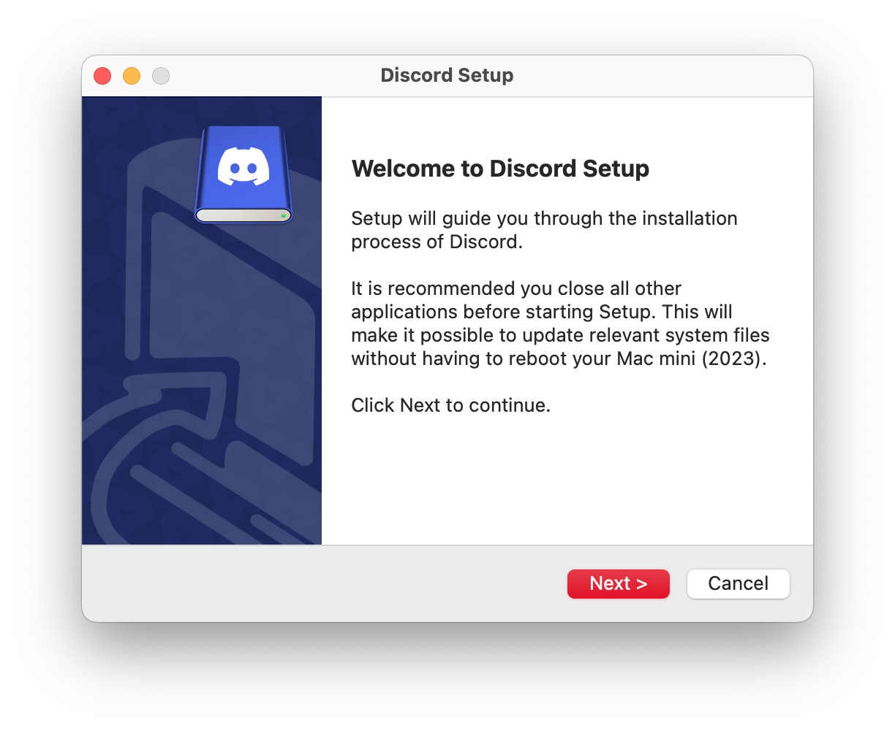
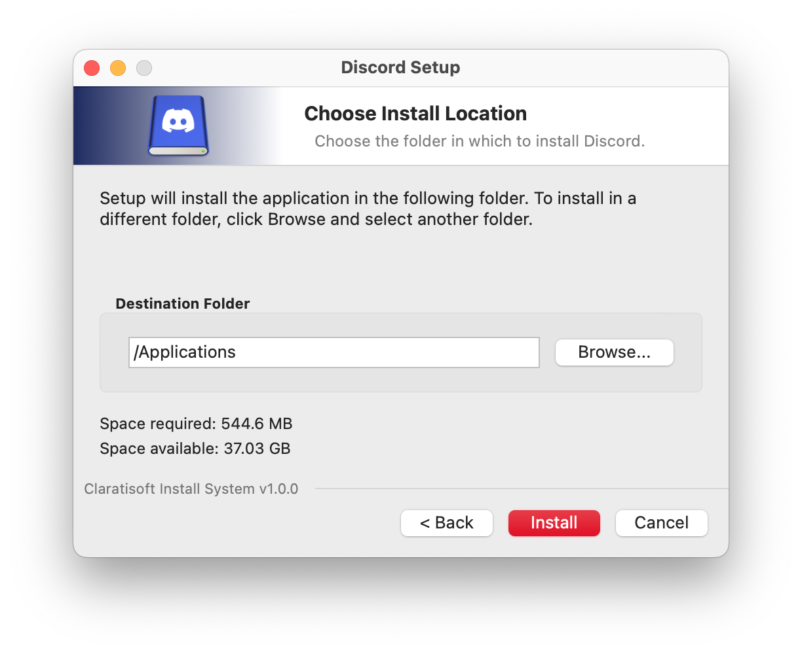
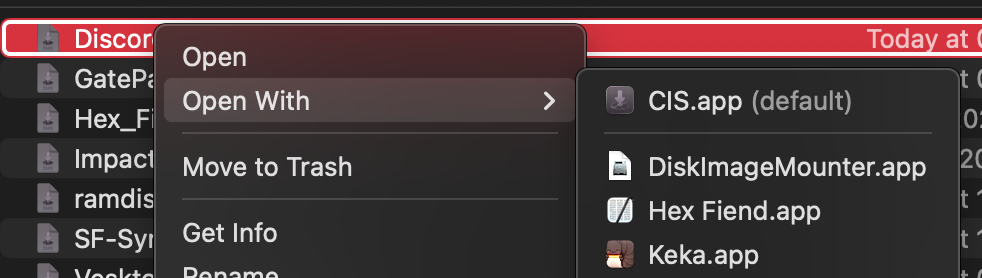
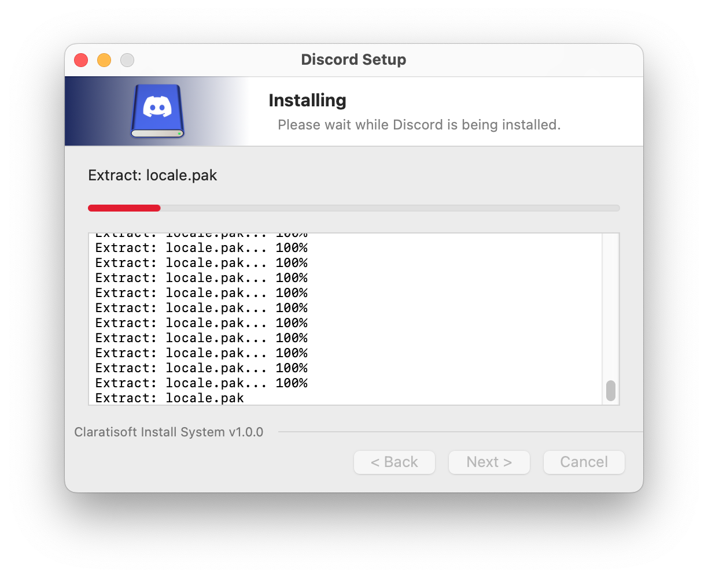

## CIS

[](https://github.com/claration/cis/blob/main/LICENSE)
[](https://github.com/sponsors/claration)

CIS, named "Claration Install System", allows you to open `.dmg` files into an installer-like interface which directly extracts apps into `/Applications` (or a path of your choosing) without the need of the pain of dragging and dropping or waiting for it to (un)mount.



If you're someone coming from Windows and now using macOS, you will recognize that this [looks like NSIS](https://nsis.sourceforge.io/Main_Page)!

After installing CIS, you will see that by default it won't open `.dmg` as Disk Image Mounter takes ownership. You can mitigate this by opening CIS, then CIS will do its thing and use `NSWorkspace` to gain ownership, once thats done, will show an alert saying that it's successful. You can also optionally change it manually within another app that manages which apps own which UTI's.

<br clear="left" />



Once that is all complete, you should be able to double click a `.dmg` file and it'll show the installer interface! You will have options on where the installer installs the apps to, along with having an option to open the app automatically after installing.



<br clear="right" />



Here's an example of CIS installing [Discord](https://discord.com/)'s distributed `.dmg` file. It should work with most of these files, it just depends on how distributes made them.

[SF Symbols](https://developer.apple.com/sf-symbols/) is not supported due to their `.dmg` housing a `.pkg` file instead of the required `.app` that CIS needs.


CIS should also support parsing `.dmg`'s with HFS+ and APFS volumes! Raw disk images will mostly vary in support, and most of the time they don't even have applications anyway, so CIS will notify you if there's nothing that's important that it's able to install.

<br clear="left" />

## Building

You will need [Xcode](https://developer.apple.com/xcode/) for compilation. For packaging a `.dmg`, you will need Homebrew and will need to install some dependencies, look below for more information.

```sh
$ git clone https://github.com/claration/cis.git
$ cd cis
$ make build # optionally add DMG=1 for dmg
```

<details>
<summary>DMG building (click to expand)</summary>

When making a DMG, there's only one dependency you need and it's from Homebrew (sadly!)\

```sh
$ brew install create-dmg
```

</details>

The output of the app will be in `_build/Applications/*.app` | `_build/*.dmg`

> [!IMPORTANT]
> When debugging, CIS is going to try and by default open to a hardcoded path on my computer (sorry!). This is for testing purposes and having convenient access to a debugger.

## Download

Visit [releases](https://github.com/claration/cis/releases) and get the latest version for your computer.

## Sponsors

| Thanks to all my [sponsors](https://github.com/sponsors/claration)!! |
|:-:|
|  |
| _**"samara is cute" - Vendicated**_ |

## Acknowledgements

- [CLARATION](https://github.com/claration) – The maker.
- [NSIS](https://nsis.sourceforge.io/Main_Page) – NSIS assets, however I recreated them so they're higher quality,

## License

Project is licensed under the MIT license. You can see the full details of the license [here](https://github.com/claration/cis/blob/main/LICENSE).
